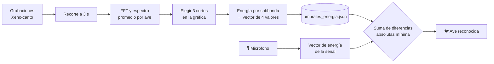

<div align="center">

# 🐦 Reconocimiento de aves por análisis de bancos de filtros

**Clasifica el canto de un ave capturado en vivo desde el micrófono usando solo FFT y energías por subbanda.**


[📄 **Leer el informe completo**](https://docs.google.com/document/d/1oCGEv72YOLi84DGnrPT9dZm9Xjg5r96cRKu0KXfORns/edit?usp=sharing)

</div>

---

##¿Qué hace?

Este proyecto reconoce **tres especies de aves** a partir de su canto, sin redes neuronales: cada especie se resume en un **vector de cuatro energías** y el audio nuevo se asigna a la especie cuyo vector se parece más.

| Ave | Especie |
|---|---|
| Mirla | *Turdus fuscater* |
| Copetón | *Zonotrichia capensis* |
| Bichofué | *Pitangus sulphuratus* |

**Características**

- 🎛️ **Entrenamiento interactivo:** tú eliges sobre la gráfica los 3 puntos que dividen el espectro en 4 subbandas.
- 🎙️ **Reconocimiento en vivo:** graba 3 s desde el micrófono y muestra el resultado al instante.
- 📊 **Resultados claros:** vector de energías, diferencias absolutas por subbanda y comparación de espectros.
- 🔎 **Zoom** en todas las gráficas (barra de herramientas de Matplotlib).
- 💾 **Modelo en JSON plano**, fácil de leer y versionar.

---

## 🧠 ¿Cómo funciona?



### Fórmulas

**Espectro** de una grabación y **espectro promedio** de las $M$ grabaciones de una ave:

$$\|X(k)\| = \left|\,\mathrm{fft}(x)\,\right| \qquad\qquad \|C(k)\|_m = \frac{1}{M}\sum_{j=1}^{M}\|C_j(k)\|$$

**Energía** de cada subbanda $i$ (con $N_i$ puntos) y **vector de umbrales**:

$$E_{Ci} = \frac{1}{N_i}\sum_{k=0}^{N_i-1}\|C_i(k)\|_m^{2} \qquad\qquad E_C = \left[E_{C1}\;\;E_{C2}\;\;E_{C3}\;\;E_{C4}\right]$$

**Decisión:** se suman las diferencias absolutas entre el vector de la señal $X$ y el de cada ave, y gana la menor.

$$E_{XC} = \sum_{i=1}^{4}\left|E_{Xi}-E_{Ci}\right| \qquad\qquad \text{tipo}_X = \min\{E_{XC},\,E_{XD},\,\dots\}$$

---

## 🗂️ Estructura del proyecto

```
.
├── DownloaderData.py      # Descarga y valida grabaciones (API de Xeno-canto)
├── audioAnalizer.py       # Analiza duraciones y recorta cada audio a 3 s
├── preprocesamiento.py    # Parámetros de audio (fs, duración) y normalización
├── core.py                # ★ Núcleo: espectro, promedio, energía, diferencias
├── trainer.py             # Lógica de entrenamiento y guardado del modelo
├── recognizer.py          # Grabación en vivo y decisión
├── app.py                 # Interfaz gráfica (entrenamiento + reconocimiento)
├── graficas.py            # Gráficas de espectros para el informe
├── requirements.txt
├── audio/                 # MP3 originales      (se genera)
├── audio_3s/              # WAV recortados a 3 s (se genera)
├── models/
│   └── umbrales_energia.json   # Modelo entrenado (se genera)
└── graficas/              # Imágenes de espectros (se genera)
```

> `core.py` contiene únicamente las fórmulas; la lectura de archivos y la interfaz están en otros módulos.

---

## 🚀 Instalación

```bash
git clone <https://github.com/Navarro0k/reconocimiento-de-audio-por-bancos-de-filtros/>
cd <https://github.com/Navarro0k/reconocimiento-de-audio-por-bancos-de-filtros/>

python -m venv venv
source venv/bin/activate        # Windows: venv\Scripts\activate

pip install -r requirements.txt
```

Para **descargar las grabaciones** necesitas una API key de [Xeno-canto](https://xeno-canto.org). Crea un archivo `.env` en la raíz:

```env
API_KEY_XENOCANTO=tu_clave_aqui
```

---

## ▶️ Uso

**1. Descargar las grabaciones** (hasta 100 por especie, calidad A, mínimo 3 s)

```bash
python DownloaderData.py
```

**2. Recortar a 3 s** (toma la ventana de mayor energía de cada audio)

```bash
python audioAnalizer.py
```

**3. Abrir la aplicación**

```bash
python app.py
```

| Pestaña | Qué hacer |
|---|---|
| **Entrenamiento** | `Cargar espectros` → clic izquierdo en la gráfica para marcar **3 cortes** (clic derecho deshace) → `Entrenar y guardar` |
| **Reconocimiento** | `Grabar 3 s y reconocer` → acerca el micrófono al canto y mira el resultado |

> 💡 Si usas la lupa o el modo mover de la barra de zoom, los clics no agregan cortes: desactívala para marcarlos.

**4. (Opcional) Generar las gráficas del informe**

```bash
python graficas.py
```

---

## 📦 Formato del modelo

`models/umbrales_energia.json` guarda la frecuencia de muestreo, los cortes en Hz y el vector de energías de cada ave (los valores son un ejemplo):

```json
{
    "fs": 22050,
    "cortes_hz": [3500, 6000, 9000],
    "energias": {
        "Carpeta_Mirla":    [ 10.11, 6001.22, 40.00, 9.50 ],
        "Carpeta_Copeton":  [ 0.00, 0.00, 0.00, 0.00 ],
        "Carpeta_Bichofue": [ 0.00, 0.00, 0.00, 0.00 ]
    }
}
```

---

## 🖼️ Capturas

<!-- Reemplaza estas rutas por tus imágenes -->
| Entrenamiento | Reconocimiento |
|:---:|:---:|
|  |  |

---

## ⚠️ Consideraciones

- La comparación usa **energías absolutas, sin logaritmos**, así que depende del nivel de la señal. Por eso las grabaciones se normalizan igual en el entrenamiento y en el reconocimiento en vivo.
- Para mejores resultados, graba con el ave **cerca del micrófono** y con poco ruido de fondo.
- Más grabaciones por especie y más subbandas reducen el margen de error.

---

## 🛠️ Tecnologías

Python · NumPy · SciPy · Matplotlib · CustomTkinter · sounddevice · mutagen · ffmpeg

## 📚 Datos

Grabaciones obtenidas de [Xeno-canto](https://xeno-canto.org), base colaborativa de sonidos de aves. Cada grabación pertenece a su autor y conserva su licencia original.

## 👥 Autores

- [Nombre 1] — [@navarro0k](https://github.com/navarro0k)
- [Nombre 2] — [@dassg-xd](https://github.com/dassg-xd)

Proyecto final de [Procesamiento de Imágenes y Señale] · [Universidad de los Llanos] · 2026
