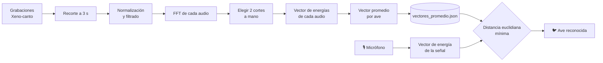

<div align="center">

# 🐦 Reconocimiento de aves por análisis de bancos de filtros

**Clasifica el canto de un ave capturado en vivo desde el micrófono usando solo FFT y energías por subbanda.**


[📄 **Leer el informe completo**](https://docs.google.com/document/d/1oCGEv72YOLi84DGnrPT9dZm9Xjg5r96cRKu0KXfORns/edit?usp=sharing)

</div>

---

## ¿Qué hace?

Este proyecto reconoce **dos especies de aves** a partir de su canto, sin redes neuronales: cada especie se resume en un **vector de tres energías** y el audio nuevo se asigna a la especie cuyo vector se parece más.

| Ave | Especie |
|---|---|
| Mirla | *Turdus fuscater* |
| Copetón | *Zonotrichia capensis* |

**Características**

- 🎛️ **Entrenamiento interactivo:** tú eliges sobre la gráfica los 2 puntos que dividen el vector FFT en 3 subbandas.
- 🎙️ **Reconocimiento en vivo:** graba 3 s desde el micrófono y muestra el resultado al instante.
- 📊 **Resultados claros:** vector de energías, diferencias por subbanda, distancia euclidiana y comparación de espectros.
- 🐤 **Imagen del ave reconocida** junto al resultado.
- 🔎 **Zoom** en todas las gráficas (barra de herramientas de Matplotlib).
- 💾 **Modelo en JSON plano**, fácil de leer y versionar.

---

## 🧠 ¿Cómo funciona?



### Fórmulas

**Espectro** de una señal (la FFT se aplica a la señal ya normalizada y filtrada):

$$\|X(k)\| = \left|\,\mathrm{fft}(x)\,\right|$$

**Energía promedio** de cada subbanda $i$ (con $N_i$ puntos) de una señal, y su **vector de energías**:

$$E_{i} = \frac{1}{N_i}\sum_{k}\|X_i(k)\|^{2} \qquad\qquad E = \left(E_{1}\;\;E_{2}\;\;E_{3}\right)$$

**Vector promedio** de una ave $C$ con $M$ grabaciones:

$$E_{C} = \frac{1}{M}\sum_{j=1}^{M}E^{(j)}$$

**Decisión:** distancia euclidiana entre el vector de la señal $X$ y el de cada ave; gana la menor.

$$d_C = \|E_X - E_C\| = \sqrt{\sum_{i=1}^{3}\left(E_{Xi}-E_{Ci}\right)^2} \qquad\qquad \text{tipo}_X = \arg\min_C\, d_C$$

**Partición:** el vector FFT completo ($k = 0,\dots,N-1$) se divide en 3 subbandas; la tercera incluye la mitad reflejada. Los cortes se escogen para que las energías de las subbandas equivalentes de cada ave sean muy diferentes. En la aplicación se marcan manualmente con clic izquierdo sobre la gráfica.

**Verificación:** `python verificar_documento.py` calcula el ejemplo de 8 puntos del documento con las funciones de `core.py` y compara cada resultado con el del documento.

**Normalización y filtrado** (agregado al documento; igual al entrenar y al reconocer, antes de la FFT): la señal se normaliza a un pico de 0.9 con cuantización de 16 bits y se filtra con una media móvil de $M$ puntos. La implementación y los parámetros están en `filtro.py`.

El espectro promedio $\|C(k)\|_m$ se usa solo para las gráficas.

---

## 🗂️ Estructura del proyecto

```
.
├── DownloaderData.py      # Descarga y valida grabaciones (API de Xeno-canto)
├── audioAnalizer.py       # Analiza duraciones y recorta cada audio a 3 s
├── filtro.py              # Parámetros, normalización y filtro de media móvil
├── verificar_documento.py # Comprueba core.py con el ejemplo de 8 puntos del documento
├── core.py                # ★ Núcleo: espectro, energía, energía promedio, distancia euclidiana
├── utilidades.py          # Apoyo: frecuencias, índices de corte y validación (no son fórmulas)
├── trainer.py             # Lógica de entrenamiento y guardado del modelo
├── recognizer.py          # Grabación en vivo y decisión
├── app.py                 # Interfaz gráfica (entrenamiento + reconocimiento)
├── graficas.py            # Gráficas de espectros para el informe
├── requirements.txt
├── audio/                 # MP3 originales      (se genera)
├── audio_3s/              # WAV recortados a 3 s (se genera)
├── imagenes/              # Pixel art de cada ave (copeton.png, mirla.png)
├── models/
│   └── vectores_promedio.json   # Modelo entrenado (se genera)
└── graficas/              # Imágenes de espectros (se genera)
```

> `core.py` contiene únicamente las fórmulas; la lectura de archivos y la interfaz están en otros módulos.

---

## 🚀 Instalación

```bash
git clone <https://github.com/Navarro0k/reconocimiento-de-audio-por-bancos-de-filtros/>
cd <https://github.com/Navarro0k/reconocimiento-de-audio-por-bancos-de-filtros/>

python -m venv venv
source venv/bin/activate        # Windows: venv\Scripts\activate

pip install -r requirements.txt
```

Para **descargar las grabaciones** necesitas una API key de [Xeno-canto](https://xeno-canto.org). Crea un archivo `.env` en la raíz:

```env
API_KEY_XENOCANTO=tu_clave_aqui
```

---

## ▶️ Uso

**1. Descargar las grabaciones** (hasta 100 por especie, calidad A, mínimo 3 s)

```bash
python DownloaderData.py
```

**2. Recortar a 3 s** (toma la ventana de mayor energía de cada audio)

```bash
python audioAnalizer.py
```

**3. Abrir la aplicación**

```bash
python app.py
```

| Pestaña | Qué hacer |
|---|---|
| **Entrenamiento** | `Cargar espectros` → clic izquierdo en la gráfica para marcar **2 cortes** (clic derecho deshace) → `Entrenar y guardar` |
| **Reconocimiento** | `Grabar 3 s y reconocer` → acerca el micrófono al canto y mira el resultado |

> 💡 Si usas la lupa o el modo mover de la barra de zoom, los clics no agregan cortes: desactívala para marcarlos.

**4. (Opcional) Generar las gráficas del informe**

```bash
python graficas.py
```

---

## 📦 Formato del modelo

`models/vectores_promedio.json` guarda el método de entrenamiento, la frecuencia de muestreo, los cortes en Hz y el vector promedio de energías de cada ave (los valores son un ejemplo):

```json
{
    "metodo": "vector_completo_euclidiana",
    "fs": 22050,
    "cortes_hz": [3000, 4750],
    "vectores_promedio": {
        "Carpeta_Mirla":    [ 10.11, 6001.22, 40.00 ],
        "Carpeta_Copeton":  [ 0.00, 0.00, 0.00 ]
    }
}
```

---

## 🖼️ Capturas

<!-- Reemplaza estas rutas por tus imágenes -->
| Entrenamiento | Reconocimiento |
|:---:|:---:|
|  |  |

---

## ⚠️ Consideraciones

- La comparación usa **energías absolutas, sin logaritmos**, así que depende del nivel de la señal. Por eso las grabaciones se normalizan igual en el entrenamiento y en el reconocimiento en vivo.
- Para mejores resultados, graba con el ave **cerca del micrófono** y con poco ruido de fondo.
- Más grabaciones por especie y más subbandas reducen el margen de error.

---

## 🛠️ Tecnologías

Python · NumPy · SciPy · Matplotlib · CustomTkinter · sounddevice · mutagen · ffmpeg

## 📚 Datos

Grabaciones obtenidas de [Xeno-canto](https://xeno-canto.org), base colaborativa de sonidos de aves. Cada grabación pertenece a su autor y conserva su licencia original.

## 👥 Autores

- [Nombre 1] — [@navarro0k](https://github.com/navarro0k)
- [Nombre 2] — [@dassg-xd](https://github.com/dassg-xd)

Proyecto final de [Procesamiento de Imágenes y Señale] · [Universidad de los Llanos] · 2026
